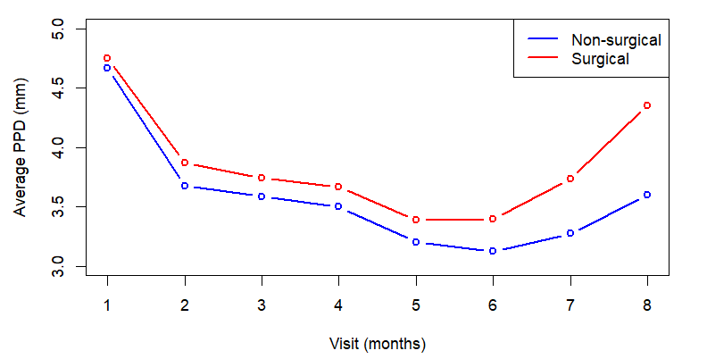
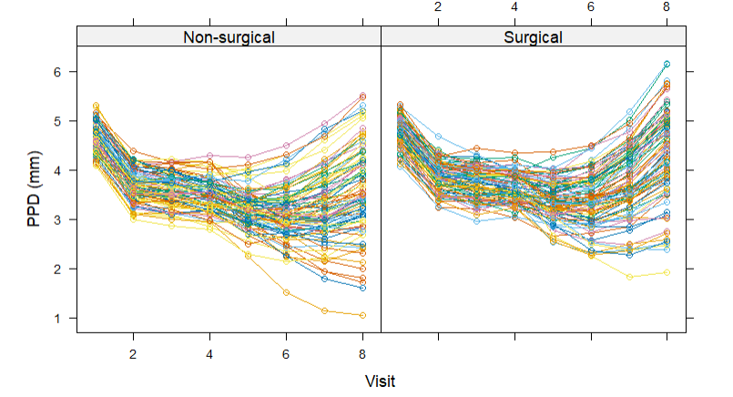
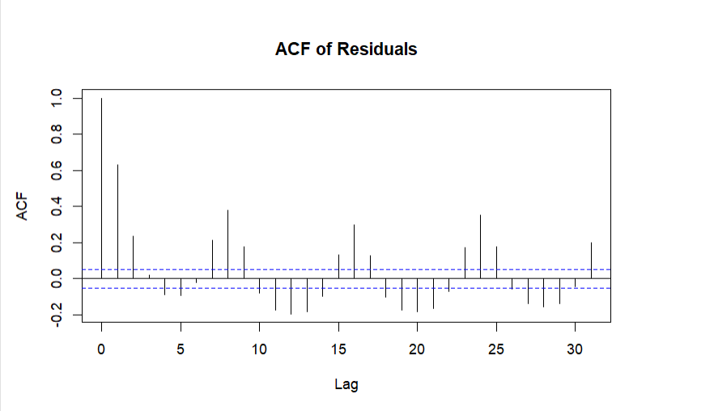
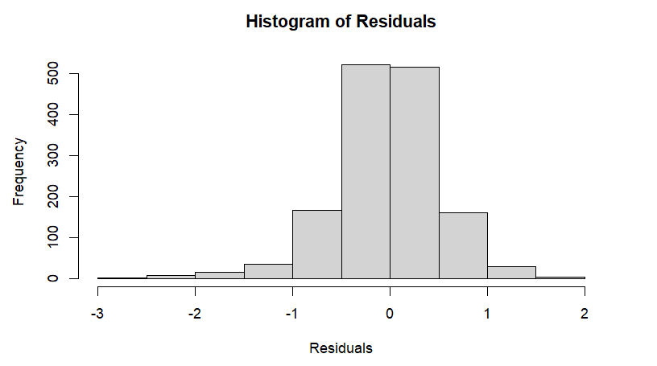
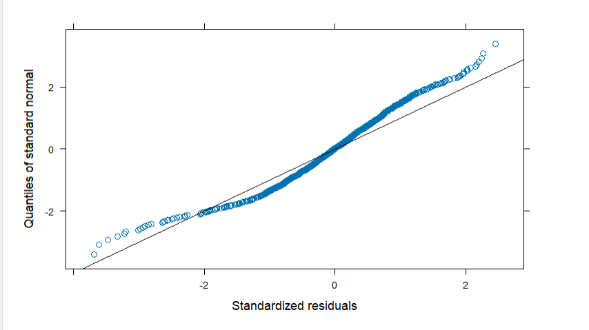
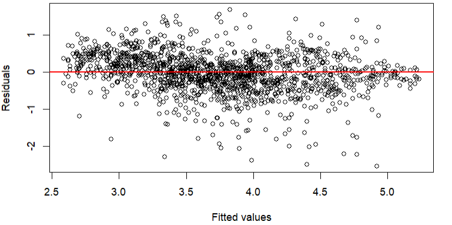
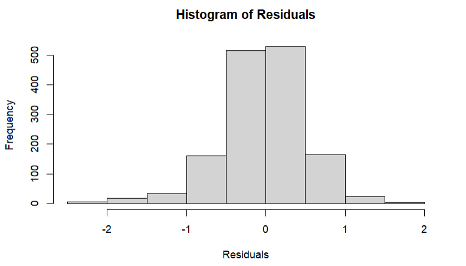
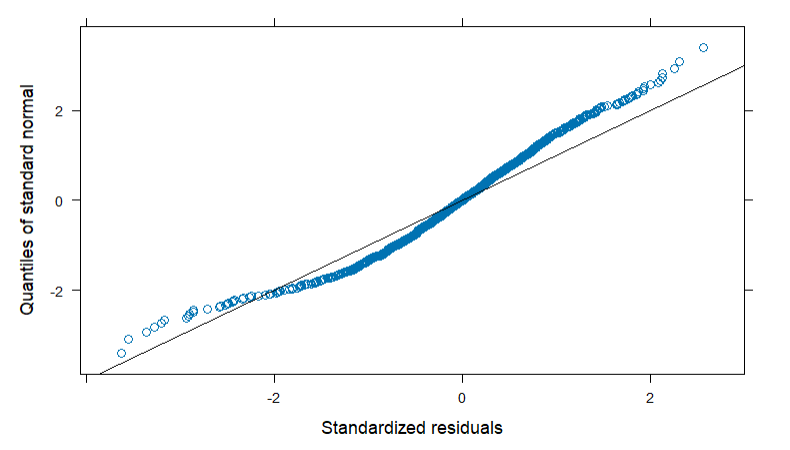
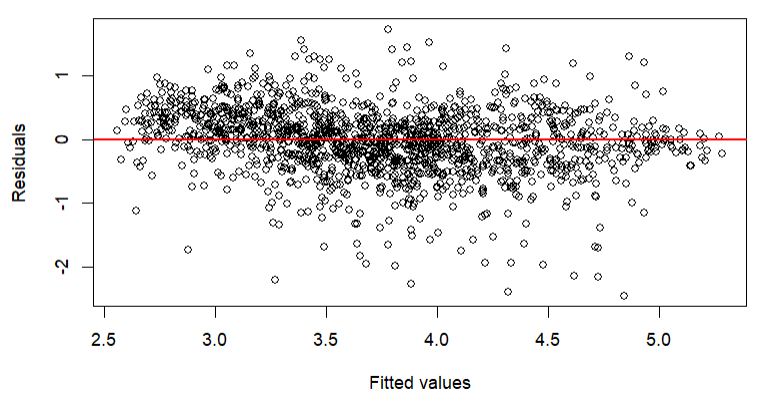

# Surgical vs. Non-Surgical Periodontal Therapy: A Longitudinal Analysis

Comparing how periodontal pocket depth (PPD) changes over 14 months under surgical and non-surgical therapy, using generalized least squares (GLS) and linear mixed-effects (LME) models for repeated measures.

**Course project, Applied Mixed Models, Western Michigan University (April 2026)**
Team: Theophilus Nyarko, Livingstone Kwame Sabah, Noran Novat

📄 [Full report (PDF)](report/periodontal_therapy_report.pdf) · 💻 [R code](code/periodontal_analysis.R)

---

## Problem

Periodontitis destroys the tissues that support the teeth and, if untreated, leads to tooth loss. Surgical therapy is more expensive than non-surgical therapy, and earlier studies suggest its short-term advantage may fade over time. This project asks three questions:

1. Does the rate of change in PPD differ between surgical and non-surgical therapy?
2. Is surgical therapy more or less effective in patients who are current smokers with moderate-to-heavy alcohol use?
3. Do periodontal conditions improve the model beyond demographic factors?

## Data

- Randomized clinical trial of **182 patients** with moderate to severe periodontitis
- Outcome: average PPD across each patient's teeth (mm)
- **8 visits:** baseline, then every 2 months up to 14 months
- Covariates: age, race, BMI, HbA1c, smoking, alcohol use, and periodontal conditions (number of teeth, plaque index, gingival index, bleeding on probing, CRP, rheumatoid factor)

> The dataset is not included in this repository. Only the analysis code, figures, and report are shared.

## Methods

- **Exploratory analysis:** mean and individual (spaghetti) PPD trajectories, baseline distributions, and the residual autocorrelation function (ACF)
- **Time trend:** linear vs. quadratic trends compared with a likelihood ratio test and AIC
- **Covariance structure:** the residual ACF did not decay as AR(1) would predict, so an **unstructured** covariance was used in GLS
- **Model selection:** covariates added one at a time and kept only if they lowered the AIC; GLS compared with a random-intercept, random-slope LME model under ML; final estimates under REML
- **Effect modification:** a treatment × smoking × alcohol interaction
- **Nested model comparison:** likelihood ratio test of demographics-only vs. demographics + periodontal conditions
- **Diagnostics:** residual histograms, Q-Q plots, and residuals vs. fitted values

## Key Findings

- PPD follows a **quadratic trajectory**: it falls from baseline to about 10 months and then rebounds in both groups.
- The **rate of change differs significantly between therapies** (p = 0.0013). Non-surgical therapy produced lower PPD than surgical therapy, after adjusting for age.
- There was **no evidence** that surgical therapy works differently for current smokers with moderate-to-heavy alcohol use (p = 0.73).
- Adding the **plaque index** improved model fit (likelihood ratio test, p = 0.027); other periodontal conditions did not.
- GLS with an unstructured covariance fit better than the LME model.



<details>
<summary>More figures</summary>

**Individual patient trajectories**


**ACF of residuals** (motivates the unstructured covariance)


**Model 1A diagnostics**




**Model 3A diagnostics**




</details>

## Limitations

- Averaging PPD across teeth hides tooth-level variation, even though periodontitis is site-specific.
- Fourteen months may be too short to capture long-term differences, especially given the late rebound in PPD.
- Model selection by AIC and significance may exclude clinically relevant variables.

## Repository Structure

```
├── README.md
├── code/
│   └── periodontal_analysis.R
├── report/
│   └── periodontal_therapy_report.pdf
└── figures/
    ├── 01_mean_ppd_by_treatment.png
    ├── 02_individual_trajectories.png
    ├── 03_acf_residuals.png
    ├── 04–06_model1A_*.png
    └── 07–09_model3A_*.png
```

## How to Run

1. Place the dataset at `data/periodontal.csv` (not included).
2. From the repository root, run `Rscript code/periodontal_analysis.R`.
3. The script prints model summaries and saves all figures to `figures/`.

In the dataset, the plaque index column is named `plague`, so the code uses that name.

## Tools

R: `nlme` (GLS, LME), `lattice`, `reshape2`, `dplyr`, `ggplot2`
